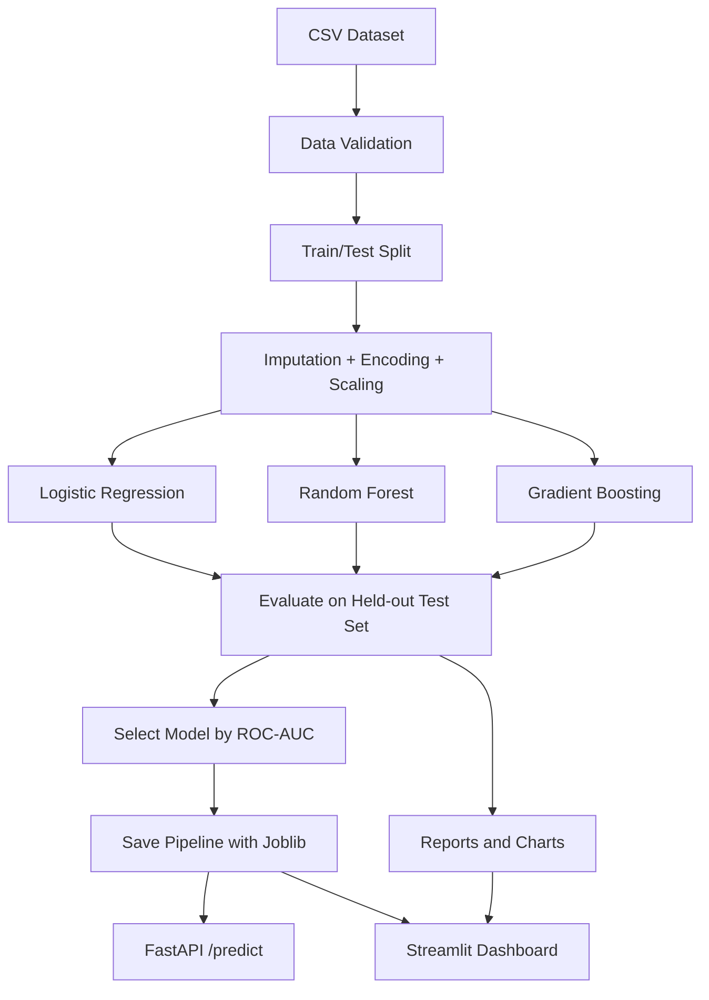

# System Architecture

## Components
1. **Data layer** — CSV dataset under `data/raw/`; the default dataset is synthetic.
2. **Training layer** — `src/train.py` creates a preprocessing + estimator pipeline and compares three classifiers.
3. **Artifact layer** — best fitted pipeline and metadata are stored in `models/`.
4. **Evaluation layer** — CSV metrics, classification report, ROC curves, confusion matrix, and feature importance are stored in `reports/`.
5. **Inference API** — FastAPI validates customer input, loads the trained pipeline, and returns prediction/probability.
6. **Dashboard** — Streamlit reads the dataset and reports, and uses the saved pipeline for interactive predictions.

## Data flow

## Reproducibility and leakage prevention
The preprocessing transformer is part of each scikit-learn pipeline. It is fitted on training data only, and then applied to the test data. The test set is not used to fit the estimators.
